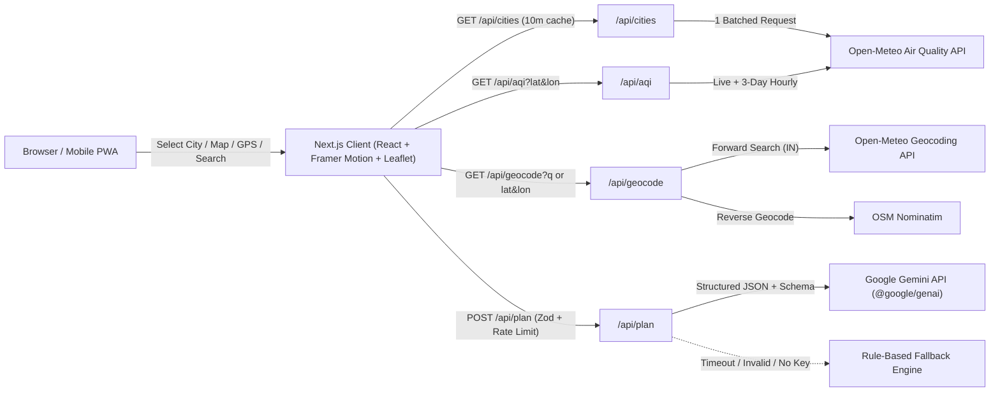

# NIRVAYU (निर्वायु) — *Breathe Smarter, India.*

A production-ready, bilingual (**English + हिंदी**), GenAI-powered clean-air assistant built with Next.js App Router, live Open-Meteo air quality & geocoding APIs, Leaflet/OpenStreetMap, and Google Gemini (`@google/genai`).

---

## Problem Statement

Winter thermal inversion, vehicular exhaust, biomass cooking, and open waste burning expose millions of Indian families to hazardous PM2.5 and PM10 levels. Most AQI apps only show a raw number—leaving families unsure *when* it is safest to step outside, *how* to lower indoor exposure on a tight budget, or *which* daily habits meaningfully reduce both personal inhaled pollution and carbon emissions.

**NIRVAYU** turns live local air quality into practical, culturally relevant, low-cost household action plans for **any city, town, or coordinate in India**.

---

## Core Features

- **Interactive Live Map of India** (`react-leaflet` + OpenStreetMap):
  - Displays **28 major Indian cities** (Delhi, Mumbai, Kolkata, Chennai, Bengaluru, Hyderabad, Bhopal, Indore, Raipur, Lucknow, Patna, Jaipur, Ahmedabad, Pune, Chandigarh, Ranchi, Nagpur, Varanasi, Kanpur, Guwahati, Bhubaneswar, Dehradun, Srinagar, Kochi, Visakhapatnam, Surat, Amritsar, Thiruvananthapuram) fetched in **one batched Open-Meteo request** and cached server-side for **10 minutes**.
  - Color-coded Indian CPCB NAQI markers (`Good`, `Satisfactory`, `Moderate`, `Poor`, `Very Poor`, `Severe`) with pulsing halos on polluted cities and an accessible legend.
  - **5 ways to pick any location in India**: click a marker, tap anywhere on the map (reverse-geocoded), search any city/town/village with India-restricted autocomplete, use browser Geolocation, or enter manual Lat/Lon coordinates.
- **Live CPCB AQI + Forecast Panel**:
  - Official Indian CPCB NAQI breakpoints across PM2.5, PM10, NO₂, O₃, CO, and SO₂, plus US AQI reference.
  - Animated semicircular gauge, pollutant tiles, 24-hour & 3-day Recharts forecast, and auto-detected **Cleanest Daytime Window**.
  - **Smog Alert Mode** banner when AQI is `Poor` or worse.
- **GenAI Clean-Air Plan (`gemini-2.5-flash`) + Resilient Fallback**:
  - Structured JSON output validated strictly with Zod (`responseMimeType: "application/json"` + `responseSchema`).
  - Covers Health Advisory, Low-Emission Daily Routine (Morning/Afternoon/Evening), Indoor Air Hacks (wet mopping, DIY MERV-13/HEPA box fan filter, N95 vs cloth mask, cooking exhaust), Sustainable Alternatives, Impact Estimator, and Interactive Checklist with confetti + streak counter.
  - Rule-based **Fallback Plan Engine** guarantees zero UI breakage even without Gemini or external AQI connectivity.
- **Bilingual (English / हिंदी)**, **City Compare Mode**, **Share Summary**, **PWA Support** (`/manifest.webmanifest`, service worker, `/offline`), and **Dark/Light Theme**.

---

## Screenshots

Placeholder directory: [`/docs/screenshots`](./docs/screenshots/README.md)

---

## Architecture



---

## Tech Stack

- **Framework**: Next.js (App Router), TypeScript, Tailwind CSS v4
- **Animation & UI**: `framer-motion`, `lucide-react`, `canvas-confetti`, `recharts`
- **Maps**: `leaflet`, `react-leaflet`, OpenStreetMap tiles (zero paid keys)
- **Live Air & Geo APIs**: Open-Meteo Air Quality & Geocoding APIs, OSM Nominatim
- **GenAI**: Google Gemini API (`@google/genai`, `gemini-2.5-flash`)
- **Validation & Testing**: `zod`, `vitest`

---

## Design Decisions

- **Mascot ("Vayu")**: A custom lightweight inline SVG cloud-lung mascot with zero external image weight. Vayu dynamically adapts facial expression, N95 mask, cough puffs, and bilingual speech-bubble tips to the live CPCB category.
- **Motion System**: GPU-composited `transform` and `opacity` animations via `framer-motion`, wrapped in `<MotionConfig reducedMotion="user">` plus CSS `prefers-reduced-motion` overrides for accessibility and 60fps mobile responsiveness.
- **Accessibility**: Text labels always accompany CPCB color badges; interactive controls maintain ≥44px touch targets; keyboard `/` shortcut focuses search; high-contrast dark navy (`#08111E`) and light sky modes.
- **Mobile-First UX**: Full-screen map on mobile paired with a 3-snap-point (`peek`, `half`, `full`) draggable bottom sheet and thumb-friendly bottom navigation.

---

## Security Measures

- **Server-Side Secrets Only**: `GEMINI_API_KEY` is read strictly inside `/api/plan` on the server—never exposed in `NEXT_PUBLIC_*` variables.
- **Strict Zod Validation**: Every API route validates coordinates inside India's bounding box (`Lat 6.0–37.6, Lon 68.0–97.5`), enforces string lengths and enums, and rejects unknown fields via `.strict()`.
- **Prompt Injection Defense**: User profile and location inputs are sanitized and placed inside `<UNTRUSTED_INPUT_DATA>` delimiters; system instructions explicitly instruct Gemini to ignore any commands inside data blocks.
- **Rate Limiting**: In-memory sliding-window rate limiter (`10 req/min` on `/api/plan`, `60 req/min` on data routes). For multi-region serverless scaling on Vercel, swap `src/lib/rate-limit.ts` with `@upstash/ratelimit` + Upstash Redis.
- **Security Headers & Privacy**: `Content-Security-Policy`, `X-Frame-Options: DENY`, `X-Content-Type-Options: nosniff`, `Referrer-Policy`, `Permissions-Policy`, and `Strict-Transport-Security` configured in `next.config.ts`. No `dangerouslySetInnerHTML`. Household profiles and checklists live exclusively in browser `localStorage`.

---

## How Impact Is Calculated

1. **Indian CPCB NAQI**: Linear piecewise interpolation across PM2.5, PM10, NO₂, O₃, CO (converted from µg/m³ to mg/m³), and SO₂; overall AQI equals the maximum pollutant sub-index.
2. **Combined PM2.5 Reduction (%)**: Independent household interventions combine multiplicatively (`1 - ∏(1 - r_i)`) and are capped at ≤78% to avoid unrealistic stacking.
3. **Weekly CO₂ Savings (kg/week)**: Derived from Indian transport emission factors (~140g CO₂/km car, ~52g CO₂/km two-wheeler over 16 km × 3 trips/week), clean cooking transitions, and open-waste burn avoidance.

---

## Setup & Deployment

### Local Development

```bash
npm install
cp .env.example .env.local
# Add your GEMINI_API_KEY inside .env.local
npm run dev
```

### Verification Commands

```bash
npm test
npm run lint
npm run build
```

### Deploy to Vercel

1. Push repository to GitHub (`.env*` is gitignored; `.env.example` is included).
2. Import project in Vercel and add `GEMINI_API_KEY` under **Project Settings → Environment Variables**.
3. Deploy — Next.js App Router API routes run automatically as serverless functions.

---

## Limitations

- Open-Meteo provides modeled/assimilated regional air quality (~11 km grid resolution), which can differ slightly from hyper-local roadside CPCB monitors.
- Impact reductions and CO₂ savings are educational lifestyle estimates, not medical advice.
- The built-in rate limiter uses in-memory sliding windows per serverless instance; configure Upstash Redis for strict global rate limiting under high concurrency.
